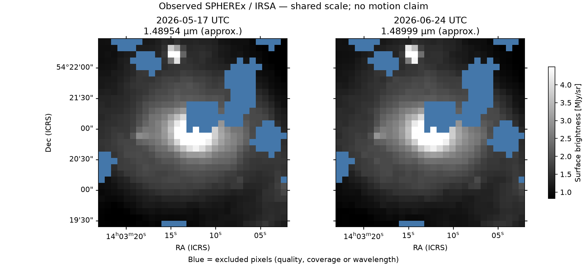

# M1 — IRSA SPHEREx data validation

This report records executed archive requests and actual FITS inspection, not mock
frontend output. Work started from clean commit `c92b686`. The session's stated
date was 2026-11-12; the execution environment recorded retrieval timestamps on
**2026-11-13 UTC**. Retrieval timestamps below are taken from the generated
manifests, not inferred from the session date.

**Outcome:** M1 feasibility established for a **visualization comparison in M101**:
two traceable QR3 observations separated by 37.68 days pass the stated spatial,
quality and approximate wavelength checks. The initial WISE field remains a
documented negative under those same thresholds. No moving-object detection is
claimed, and precision spectral/photometric validation is still outstanding.

## Official access methods checked

1. [Archive access guide](https://caltech-ipac.github.io/spherex-archive-documentation/spherex-data-access/):
   on-premises browsable directories, AWS mirror, SIA2, TAP, Python wrappers
   (Astroquery/PyVO), and the Data Explorer. Direct SIA2 HTTP requests are sufficient
   for this minimal spike; no full backend or extra query-wrapper dependency is needed.
2. [Release guide](https://caltech-ipac.github.io/spherex-archive-documentation/spherex-data-releases/):
   use DR1 and QR3. DR1 covers Surveys 1/2; QR3 covers Surveys 3/4. Together they
   supersede QR2; do not query QR2 as though it were a current searchable collection.
3. [Products guide](https://caltech-ipac.github.io/spherex-archive-documentation/spherex-data-products/):
   Level 2 spectral-image MEFs retain exposure times; the DR1 All-Sky Cube combines
   exposures and is not used here as an independent time epoch. A spectral image
   has calibrated `IMAGE`, `FLAGS`, `VARIANCE`, `ZODI`, `EPSF`, and `WCS-WAVE` HDUs.
4. [IBE cutout reference](https://irsa.ipac.caltech.edu/ibe/cutouts.html): append
   `center=<ra>,<dec>d&size=<degrees>` to the returned `access_url`. Cutouts follow
   parent detector axes, **not** a north-up orientation. SPHEREx cutouts retain
   ancillary HDUs and are not gzip-compressed. ePSF content is not spatially cropped.
5. [Official introduction](https://caltech-ipac.github.io/irsa-tutorials/spherex-intro/)
   and [cutout tutorial](https://caltech-ipac.github.io/irsa-tutorials/spherex-cutouts/):
   celestial SIP distortion is retained, while alternate spectral WCS uses the
   lookup HDU without SIP. The tutorial supplies M101 as a second candidate field.

Only the two **wide-survey** collections are queried. The `_deep` collections,
AWS download route, and TAP were reviewed in documentation but not exercised.
SIA2 can lag new ingestion by approximately one day. Live service errors must not
be interpreted as absence of data.

### Citation and licensing

The [official mission page](https://irsa.ipac.caltech.edu/Missions/spherex.html)
requests the following acknowledgement:

> This publication makes use of data products from the Spectro-Photometer for the
> History of the Universe, Epoch of Reionization and Ices Explorer (SPHEREx), which
> is a joint project of the Jet Propulsion Laboratory and the California Institute
> of Technology, and is funded by the National Aeronautics and Space Administration.

It lists Bock et al. (2026), mission; Akeson et al. (2026), pipeline; Crill et al.
(2025), sky simulator; and Korngut et al. (2026), instrument/calibration, with links
to the canonical papers. The archive files used here are publicly downloadable.
The documentation site's BSD-3-Clause notice is **not evidence of a FITS-data
license**. No separate dataset license was established in the pages checked;
confirm redistribution terms with IRSA before bundling raw observations publicly.
Bulk FITS files are not committed here.

## Reproducible environment and commands

From repository root:

```bash
cd server
uv sync --locked
uv run --locked pytest -q
uv run --locked python scripts/validate_irsa.py --output outputs/wise0855-padded
uv run --locked python scripts/validate_irsa.py \
  --ra 210.80227 --dec 54.34895 --detector 2 --output outputs/m101
```

Environment: Linux, Python **3.14.10**, uv **0.13.5**, Astropy **8.0.2**, NumPy
**2.5.4**, Matplotlib **3.11.2**, Reproject **0.21.0**, pytest **9.2.0**.
Dependencies were installed using `uv add astropy numpy matplotlib reproject`
and `uv add --dev pytest`; `server/uv.lock` records their resolved versions.
No FastAPI dependency or HTTP application was added.

`manifest.json` records the command, settings, environment, response hashes,
retrieval times, input metadata, download errors and pair decisions. Original
cutouts, SHA-256 sidecars and discovery XML are preserved in the output directory.
These files are ignored by Git. Use a fresh output directory for a fresh download;
rerunning with the same directory verifies and reuses downloaded cutouts while
querying discovery again. The manifest describes the latest run.
Completed runs are also retained in `runs/*.json` so a later failed request
cannot erase their evidence. Explicit `--offline` replay reads saved discovery
responses and hash-verified real cutouts, without making network requests.

## Candidate 1 — field near WISE 0855

Requested ICRS coordinates: **RA 133.7951°, Dec −7.2451°**. These are candidate
field coordinates from the implementation plan, not a propagated or verified
position/detection of the brown dwarf at either observation epoch.

Executed discovery queries:

```text
https://irsa.ipac.caltech.edu/SIA?COLLECTION=spherex_dr1&POS=CIRCLE+133.7951+-7.2451+0.01&MAXREC=1000
https://irsa.ipac.caltech.edu/SIA?COLLECTION=spherex_qr3&POS=CIRCLE+133.7951+-7.2451+0.01&MAXREC=1000
```

- DR1 returned **258 rows**, `QUERY_STATUS=OK`; **45** are detector 6.
- QR3 returned **0 rows**, `QUERY_STATUS=OK`, for this particular overlap query.
- An earlier diagnostic using `MAXREC=100` returned `OVERFLOW`; that response
  was not used to infer coverage or absence.
- Sampled **24** detector-6 products evenly across the time-sorted candidate list.
  This is bounded sampling, not an exhaustive search of all products or bands.

### Traceable pair inspected, but not accepted for the showcase

Both are `spherex_dr1`, detector 6, primary pipeline `VERSION=7.0.5`:

| Property | Observation A | Observation B |
|---|---|---|
| OBSID | `2025W19_1B_0116_1` | `2026W20_1A_0033_1` |
| DATE-OBS (UTC) | 2025-05-05T16:48:02.459 | 2026-05-11T02:18:44.662 |
| MJD-OBS | 60800.700028461 | 61171.096350255 |
| Local wavelength, approximate (µm) | 4.968428007864598 | 4.968384021969238 |
| Local bandwidth, approximate (µm) | 0.03718634457010945 | 0.03718599551489554 |
| Padded science shape (rows × columns) | 59 × 59 | 58 × 58 |
| Valid input fraction | 0.9609307670 | 0.9750297265 |
| Header PSF FWHM (arcsec) | 9.0419404025 | 9.0419404025 |
| Median IMAGE (MJy/sr, padded region) | 0.7205244899 | 0.7812311053 |
| Median ZODI model (MJy/sr, padded region) | 0.6846885085 | 0.7531110644 |

Actual product/cutout URLs:

```text
https://irsa.ipac.caltech.edu/ibe/data/spherex/dr1/level2/2025W19_1B/l2b-v27-2026-197/6/level2_2025W19_1B_0116_1D6_spx_l2b-v27-2026-197.fits?center=133.7951%2C-7.2451d&size=0.1
https://irsa.ipac.caltech.edu/ibe/data/spherex/dr1/level2/2026W20_1A/l2b-v27-2026-246/6/level2_2026W20_1A_0033_1D6_spx_l2b-v27-2026-246.fits?center=133.7951%2C-7.2451d&size=0.1
```

| Cutout | Retrieval UTC | Bytes | SHA-256 |
|---|---|---:|---|
| A | 2026-11-13T04:13:49.442293+00:00 | 3997440 | `013e2815ac47376b545e3dca1b25b4e500c61a65d07013cfa8e5affda27b6aa8` |
| B | 2026-11-13T04:13:15.597714+00:00 | 3997440 | `6de76fdda0fe7f27418158abe2c774ee66452ca3d7f4b9c9a1686c2dba804d85` |

`DATE` in A is 2026-07-17T05:10:56.641, but its header explicitly describes
this as **HDU creation time**. The script uses `DATE-OBS` / `MJD-OBS` and checks
agreement with discovery `t_min`; it never treats processing dates as epochs.

Actual units: `IMAGE` is `MJy / sr`; `VARIANCE` is `MJy2 / sr2`. Four image
extensions share the cutout shape. `EPSF` is a 441-row binary table; `WCS-WAVE`
is a one-row table with 9-element X/Y axes and a 9×9×2 wavelength/bandwidth grid.
Spectral history identifies `spectral_wcs_6_v3.0.fits`.

The observed native nominal scales are approximately 6.15–6.16 arcsec/pixel.
Celestial projections are TAN-SIP, ICRS. Target coordinate round-trip errors
were approximately 3.16e−7 and 2.32e−7 arcsec, respectively. This checks numerical
WCS consistency, **not** absolute astrometric accuracy against an external catalog.

### Results and negative evidence

- First tight 3-arcmin download run: 4 center-compatible pairs. Best spectral
  match has **370.396321794 days** separation, but only **64.1111%** common
  valid/matched coverage on a 30×30 north-up grid. Rotated native cutout edges
  clip the output field. Current script can reproduce this geometry diagnostic
  using `--download-padding 1`.
- Padded 6-arcmin downloads, compared on the unchanged inner 3-arcmin grid:
  best pair has **78.6667%** common valid/matched coverage. Maximum local spectral
  offset within retained pixels is **0.0012709001 bandwidths**. Quality-mask
  rejection and bilinear interpolation around invalid pixels still prevent
  reaching the **unchanged 80%** threshold.
- The other three candidate pairs only retain **48.8889%**, **37.5556%**, and
  **47.3333%** grid coverage after the per-pixel spectral tests. A matching
  detector and a close central wavelength alone would overstate comparability.
- During the first padded run, A and `2025W50_2A_0254_1` returned HTTP **503**
  on both attempts. A subsequent execution succeeded for those downloads and
  verified the other 22 cached cutouts. No synthetic fallback was used.
- The final WISE-field padded run (04:13:34.961417–04:13:52.798927 UTC) returned
  exit **2**, `no_suitable_pair_in_bounded_sample`. This is a negative result
  under stated engineering thresholds, **not** a statement that WISE 0855 is
  absent, or that the archive has no usable images. Next field tested: M101.

## Candidate 2 — M101: accepted visualization pair

Requested ICRS coordinates: **RA 210.80227°, Dec 54.34895°**; detector **2**;
6-arcmin downloads, inner 3-arcmin comparison. Original successful run:
**2026-11-13T04:15:19.397885–04:16:54.513759 UTC**, exit **0**,
`visualization_pair_validated`. Repeated execution using verified cached cutouts
also returned exit 0 with the same selected observations and comparison metrics.

Executed discovery queries:

```text
https://irsa.ipac.caltech.edu/SIA?COLLECTION=spherex_dr1&POS=CIRCLE+210.80227+54.34895+0.01&MAXREC=1000
https://irsa.ipac.caltech.edu/SIA?COLLECTION=spherex_qr3&POS=CIRCLE+210.80227+54.34895+0.01&MAXREC=1000
```

| Response | Retrieved UTC | Rows | Status | SHA-256 |
|---|---|---:|---|---|
| DR1 | 2026-11-13T04:15:20.878387+00:00 | 249 | OK | `6b52514de07fbe326f5bf52fa373a05a63efdf02dc6347ca0a0da109e51fc816` |
| QR3 | 2026-11-13T04:15:21.797101+00:00 | 130 | OK | `4d2659308aa13c57164eea8577047d31d8d25b5cb5214df072bbb58b1196d38e` |

There were **84** detector-2 candidates across these results. All **24** sampled
cutouts were successfully retrieved and inspected. Three pairs passed the center
spectral preselection; the closest spectral match below also passed the full-grid
checks. Both observations are QR3, pipeline `VERSION=7.0.5`:

| Property | Observation A | Observation B |
|---|---|---|
| OBSID | `2026W20_2A_0464_3` | `2026W26_1A_0500_1` |
| DATE-OBS (UTC) | 2026-05-17T10:58:03.117 | 2026-06-24T03:19:00.063 |
| MJD-OBS | 61177.456980521 | 61215.138195174 |
| DATE-END (UTC) | 2026-05-17T10:59:58.235 | 2026-06-24T03:20:55.181 |
| Local wavelength, approximate (µm) | 1.4895431378883874 | 1.4899859510561562 |
| Local bandwidth, approximate (µm) | 0.036450620234186645 | 0.03645977832468452 |
| Padded science shape (rows × columns) | 59 × 59 | 59 × 59 |
| Valid input fraction | 0.9029014651 | 0.9948290721 |
| Nominal pixel scales (arcsec/pixel) | 6.1242700782, 6.1483030058 | 6.1259543146, 6.1517573484 |
| Header PSF FWHM (arcsec) | 7.4607012558 | 7.4607012558 |
| Median IMAGE (MJy/sr, padded region) | 0.8752018809 | 0.8839817047 |
| Median VARIANCE ((MJy/sr)²) | 0.0010121868 | 0.0009992656 |
| Median ZODI model (MJy/sr, padded region) | 0.1247459054 | 0.1327813119 |
| Target coordinate WCS round-trip error (arcsec) | 9.7579e−8 | 4.9058e−8 |

Actual product/cutout URLs (including B's real `l2b_retry` processing path):

```text
https://irsa.ipac.caltech.edu/ibe/data/spherex/qr3/level2/2026W20_2A/l2b-v27-2026-267/2/level2_2026W20_2A_0464_3D2_spx_l2b-v27-2026-267.fits?center=210.80227%2C54.34895d&size=0.1
https://irsa.ipac.caltech.edu/ibe/data/spherex/qr3/level2/2026W26_1A/l2b_retry-v27-2026-274/2/level2_2026W26_1A_0500_1D2_spx_l2b_retry-v27-2026-274.fits?center=210.80227%2C54.34895d&size=0.1
```

| Cutout | Retrieval UTC | Bytes | SHA-256 |
|---|---|---:|---|
| A | 2026-11-13T04:16:09.044842+00:00 | 4000320 | `796ad0d5343fc41eb5999eda36cedb4f3e426b3cf500756087d35e76798d0460` |
| B | 2026-11-13T04:16:53.687688+00:00 | 4000320 | `1678d87acb560b6807fb57d2c5133a6bba5bc07e8eff33fe9afac79f2cef9b16` |

Actual HDUs: empty primary header; `IMAGE`, `FLAGS`, `VARIANCE`, `ZODI` each
59×59; `EPSF` a 441-row binary table; `WCS-WAVE` a one-row lookup table.
Science units are `MJy / sr`; variance units are `MJy2 / sr2`. Spectral history
identifies `spectral_wcs_2_v2.2.fits`. `SOURCE` flags occur in **3467** and **3466**
pixels; treating all nonzero flags as bad would incorrectly remove almost the
entire field. A contains 324 HALO-flagged pixels; B contains 10. Other flag counts
are retained in the manifest, including transient, processing-error, nonfunctional
and persistence flags.

### Alignment, display and interpretation

- Time separation: **37.681214653 days**.
- Reproject both celestial TAN-SIP inputs onto one **30×30 ICRS TAN** grid,
  centered on the requested position, with `CRPIX=(15.5,15.5)` (FITS 1-based),
  `CDELT=(-0.0017088214856592,+0.0017088214856592)` degrees/pixel. North is up,
  east is left; output scale **6.1517573484 arcsec/pixel**. Rounding the grid size
  upward makes its full width approximately 3.076 arcmin rather than exactly 3.
- Common valid and spectrally compatible area: **769 / 900 pixels = 85.4444%**.
- Maximum retained local wavelength offset: **0.012173075 bandwidths**, well
  within the explicit 0.25-bandwidth visualization threshold. Local bandwidth
  ratio also passes the ≤1.2 criterion across retained pixels.
- Bilinear reprojection of **surface brightness**, without flux normalization,
  arbitrary flips or PSF sharpening. Masks are applied before interpolation.
  Original variance and ePSF remain in downloaded MEFs; no reprojected variance
  is claimed. Only common valid, spectrally matched pixels are displayed/exported.
- Shared **linear** display limits, from combined retained 2nd–98th percentiles:
  **0.8169152443–4.4980683168 MJy/sr**. Bright pixels above this range are display-
  clipped, not altered in the aligned FITS values. Blue indicates excluded
  pixels, not astronomical emission. Display interpolation is nearest-neighbor.
- Visual inspection confirms the extended structure and compact features appear
  in corresponding sky positions. This is a WCS-aligned qualitative comparison,
  not an external astrometric calibration or a measured registration residual.
- M101 is an extended-galaxy demonstration field, **not a moving-object showcase**.
  No displacement was measured. The native ∼6.15 arcsec pixels / ∼7.46 arcsec
  header PSF and 37.68-day baseline do not support an untested claim of visible
  proper motion. No contrast enhancement is represented as new science.



Generated local artifacts: `server/outputs/m101/comparison.png`, `aligned.fits`,
and `manifest.json`. Only the small derived PNG is included with this report;
raw FITS files and cache directories are excluded. The pinned source URLs, hashes,
dates and methods above identify the comparison even if future archive ingestion
changes the candidate sample selected by a new query.

## Verification executed

- `uv sync --locked`: passed against the checked-in lockfile.
- `uv run --locked pytest -q`: **25 passed**, no warnings (offline artificial unit fixtures,
  explicitly not scientific evidence).
- Live WISE padded run: exit 2, negative comparison result as described above;
  two transient HTTP 503 failures recovered on rerun.
- Live tight-cutout diagnostic with `--download-padding 1`: repeated with final
  script, exit 2, same 64.1111% best-pair coverage.
- Live M101 run: exit 0; repeated with cached real cutouts, same pair/metrics.
- A later live M101 rerun at **2026-11-13T04:21:28 UTC** failed before discovery
  with `Network is unreachable` after both bounded attempts. This is an
  environment/connectivity blocker, not an archive no-results response. No
  stale image was described as the result of that failed run.
- Final explicit `--offline` replays: M101 exit 0 and WISE padded exit 2, with
  the same metrics as their live runs. Original cutout retrieval times/hashes
  are retained. Saved XML from early runs predates discovery sidecars, so its
  offline actual query `url` and `retrieved_utc` are explicitly null (expected
  URL from current parameters is recorded separately); original online query
  URLs/timestamps are recorded above. No missing evidence is synthesized.
- The rendered real-data PNG was opened and visually inspected.
- Independent readback of the final real `aligned.fits` verified two 30×30
  science arrays, exactly 769 common valid pixels, finite retained values, NaN
  excluded values, target centering and north-up/east-left handedness. All 24
  cached M101 cutout SHA-256 hashes were independently recomputed and matched
  their retrieval sidecars.
- Frontend lint/build/browser operation were **not** run. No frontend files,
  API contract or mock-mode behavior were changed.

## Processing and scientific limitations

The comparison criteria and all hard bounds are documented in
[`server/README.md`](../server/README.md). The script rejects every set quality bit
except informational `SOURCE`/`FULLSAMPLE`; unknown bits are also rejected. It
requires positive finite variance and finite science values before interpolation.
It does not discard source pixels merely because their flag bitmap is nonzero.

Wavelengths come from **approximate WCS-WAVE**, explicitly intended for visualization
by IRSA. Quantitative spectral comparison needs calibrated CWAVE/CBAND layers.
Background differences remain: `IMAGE` includes zodiacal light, and neither the
model nor an arbitrary fitted background is subtracted here. A display stretch
does not change the stored science values.

No PSF matching, uncertainty propagation through reprojection, precision
photometry, blind source detection, difference-image significance, or proper-motion
measurement is implemented. A common sky grid alone is not proof of identical
PSFs or astrophysical variability. No claim of Planet X or WISE 0855 detection
is supported by this spike.

The official challenge URL was attempted but returned a transport error in this
environment. Challenge-specific scoring/deliverables were not independently
verified; no rubric is inferred from repository notes.
