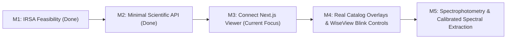

# Scientific Review: Official NASA Space Apps 2026 "Planet X and SPHEREx" Resources

**Document Date:** 2026-11-13 UTC  
**Scope:** Review of official challenge resources, comparison with current implementation (M1 & M2 completed), reusable scientific methods, and technical roadmap updates for post-integration milestones.

---

## 1. Executive Summary & Mission Context

The NASA Space Apps Challenge 2026 challenge **Planet X and SPHEREx** tasks participants with building an accessible, scientifically honest time-domain explorer for NASA's Spectro-Photometer for the History of the Universe, Epoch of Reionization and Ices Explorer (**SPHEREx**) mission. 

The core scientific deliverable is a demonstrable comparison of **real, appropriately matched SPHEREx observations at different times** to search for moving objects, brown dwarfs, or time-variable phenomena in the near-infrared ($0.75 - 5.0\,\mu\text{m}$). The challenge explicitly emphasizes scientific rigor, clear data provenance, and avoiding sensationalized, unverified claims of discovering Planet X.

This review examines four prioritized reference tools and datasets:
1. **SPHEREx Tutorial Notebooks** (`https://caltech-ipac.github.io/irsa-tutorials/spherex/`)
2. **SPHEREx Source Discovery Tool Demo** (`https://caltech-ipac.github.io/irsa-tutorials/spherex-source-discovery-tool-demo/`)
3. **Gaia DR3** (`https://archive.stsci.edu/missions-and-data/gaia` / MAST / ESA)
4. **WiseView** (`http://byw.tools/wiseview` / Backyard Worlds: Planet 9)

---

## 2. Resource Analysis

### 2.1 SPHEREx Tutorial Notebooks (IRSA)
*References:* [SPHEREx Intro](https://caltech-ipac.github.io/irsa-tutorials/spherex-intro/), [SPHEREx Cutouts](https://caltech-ipac.github.io/irsa-tutorials/spherex-cutouts/), [SPHEREx PSF](https://caltech-ipac.github.io/irsa-tutorials/spherex-psf/).

#### Architecture & Data Structures
- **Multi-Extension FITS (MEF) Format:** Level 2 spectral-image products retain un-stacked individual observation epochs. Each MEF contains:
  - `IMAGE`: Calibrated surface brightness in units of `MJy / sr`.
  - `FLAGS`: 32-bit pixel quality bitmask. Crucially, bits `SOURCE` (bit 21) and `FULLSAMPLE` (bit 12) are *informational*, not defect flags. Rejecting all non-zero flag values would erroneously discard astronomical sources.
  - `VARIANCE`: Pixel noise variance in $(\text{MJy}/\text{sr})^2$.
  - `ZODI`: Modeled zodiacal background emission in $\text{MJy}/\text{sr}$.
  - `EPSF`: 441-row binary table containing localized effective Point Spread Function models.
  - `WCS-WAVE`: Tabular spectral lookup containing the approximate wavelength solution.
- **Coordinate Systems & WCS Handling:**
  - Celestial coordinates use a **TAN-SIP** gnomonic projection with Simple Imaging Polynomial (SIP) distortion coefficients.
  - The alternate spectral WCS (Key `W`) uses the `WCS-WAVE` lookup table *without* SIP coefficients. Attempting to apply SIP distortion to the spectral lookup produces invalid wavelengths.
- **Image Orientation & Axis Rotation:**
  - SPHEREx cutouts delivered by the IRSA Image Boundary Extraction (IBE) service are aligned along the native detector axes, **not** North-up. Because the satellite rotates on sky, native square cutouts appear tilted on an ICRS equatorial grid. Downloading with 2× spatial padding is required to prevent corner clipping when reprojecting to a North-up common grid.

### 2.2 SPHEREx Source Discovery Tool (SDT)
*Reference:* [Source Discovery Tool Demo](https://caltech-ipac.github.io/irsa-tutorials/spherex-source-discovery-tool-demo/).

#### Capabilities & Reusable Workflows
- **Non-Catalog Source Detection:** Demonstrates identifying candidate objects directly from SPHEREx spectral images without relying on prior input catalogs.
- **Multi-Band & Multi-Epoch Difference Imaging:**
  - Uses localized background subtraction and grid resampling to perform image subtractions.
  - Specifically isolates extremely red near-infrared sources (such as cold brown dwarfs, protostars, and highly reddened background stars) by taking differences between long-wavelength channels (e.g., Detector 6, $4.4 - 5.0\,\mu\text{m}$) and short-wavelength channels (e.g., Detector 1/2, $0.75 - 1.5\,\mu\text{m}$).
- **Spectrophotometry Extraction:**
  - Extracts calibrated near-infrared spectra across SPHEREx's 102 continuous spectral channels ($R \sim 40 - 130$) for user-selected pixels or detected apertures.
  - Integrates aperture corrections, variance weighting, and background annulus subtraction.
- **Interactive Visualization:**
  - Connects Python analysis workflows with Firefly (IRSA's interactive FITS visualizer) and Bokeh for real-time spectral feature inspection.

### 2.3 Gaia DR3 (ESA / STScI MAST)
*Reference:* [MAST Gaia DR3 Guide](https://archive.stsci.edu/missions-and-data/gaia).

#### Data Characteristics & Astrometry
- **Astrometric Precision:** Provides absolute positions ($\alpha, \delta$), proper motions ($\mu_\alpha^* \equiv \mu_\alpha \cos \delta, \mu_\delta$ in $\text{mas/yr}$), and parallaxes ($\varpi$ in $\text{mas}$) for >1.4 billion optical sources.
- **Reference Epoch J2016.0:** Gaia DR3 positions are strictly defined at epoch **$t_0 = 2016.0$**.
- **Epoch Propagation Formula:**
  To overlay a Gaia source on a SPHEREx observation taken at epoch $t_{\text{SPHEREx}}$ (expressed in fractional Julian years, e.g., $2026.4$):
  $$\Delta t = t_{\text{SPHEREx}} - 2016.0$$
  $$\alpha(t_{\text{SPHEREx}}) = \alpha_0 + \frac{\mu_\alpha^* \cdot \Delta t}{\cos \delta_0 \cdot 3.6 \times 10^6} \quad [\text{degrees}]$$
  $$\delta(t_{\text{SPHEREx}}) = \delta_0 + \frac{\mu_\delta \cdot \Delta t}{3.6 \times 10^6} \quad [\text{degrees}]$$
- **Astrophysical Limitations:**
  - Gaia is an **optical** survey ($330 - 1050\,\text{nm}$). Very cold substellar objects (late T and Y dwarfs, with $T_{\text{eff}} < 600\,\text{K}$, such as WISE 0855) are completely undetectable by Gaia ($G > 22\,\text{mag}$) and will have **no Gaia entry**.
  - Infrared astrometric catalogs like **CatWISE2020** (epoch ~2020.0) or AllWISE must be used as complementary priors for extremely red, optical-faint objects.

### 2.4 WiseView (byw.tools/wiseview)
*Reference:* [WiseView Online Tool](http://byw.tools/wiseview), Caselden et al., Backyard Worlds: Planet 9.

#### Citizen Science UX Benchmarks
- **Rapid Time-Series Blinking:** Alternates between observation epochs at an adjustable rate (e.g., $1 - 4\,\text{Hz}$). The human visual system immediately detects moving or variable sources without machine-learning false positives.
- **Difference Imaging Mode:** Allows flipping between raw epochs and epoch-subtraction images ($I(t_2) - I(t_1)$).
- **Epoch Legends & Frame State:** Visual symbols (`+`, `-`, `.`) clearly indicate which observation epochs are active, added, or subtracted.
- **Loop Reset Indicators:** A subtle border blink or flash notifies the user when the animation loop restarts, preventing users from confusing the loop reset with physical reverse motion.
- **No False Discoveries:** WiseView never marks an unverified candidate as a "discovery"; it presents the raw infrared data with coordinate crosshairs and leaves verification to scientific cross-matching.

---

## 3. Comparative Analysis with Existing Implementation

| Dimension | Existing Implementation (M1 / M2) | Official Resources (Tutorials, SDT, Gaia, WiseView) | Gap & Recommendation |
| :--- | :--- | :--- | :--- |
| **Observation Discovery** | SIA2 queries on `spherex_dr1` and `spherex_qr3` with bounded temporal sampling. | TAP queries on `spherex.artifact` and `pyvo` / SIA2. | Current SIA2 query in `spherex.archive` is fast and robust; keep it for MVP discovery. |
| **Data Format & Masking** | Level 2 MEF reading in `spherex.fits`; strict rejection of defects while preserving `SOURCE` / `FULLSAMPLE`. | Identical MEF HDU definitions and `MSKN*` bitmap conventions. | **Fully aligned.** Current masking logic accurately follows official IRSA tutorials. |
| **Image Reprojection** | Gnomonic TAN reprojection via `reproject_interp` onto common North-up grid (`spherex.alignment`). | Reprojection using Astropy WCS and Montage/Reproject routines. | **Fully aligned.** Common grid uses the larger input pixel scale to prevent artificial oversampling. |
| **Wavelength Calibration** | Level 2 `WCS-WAVE` approximate solution (~0.01 bandwidth match). | SDT uses multi-band Level 2 images + calibrated CWAVE/CBAND tables for 102-channel spectrophotometry. | **Documented Gap.** Level 2 WCS-WAVE is sufficient for M2/M3 visualization; precision spectrophotometry deferred to M5. |
| **Proper-Motion Overlays** | Hardcoded mock offsets in `frontend/lib/mockData.ts` (`pmRa`, `pmDec`). | Real Gaia DR3 / CatWISE2020 astrometry with epoch propagation: $\Delta t = t_{\text{obs}} - 2016.0$. | **Key Gap for M4.** Real catalog cone search should be queried and propagated to the exact SPHEREx `MJD-OBS`. |
| **Time-Series UX** | 4-epoch simulation in frontend; 2 real epochs in backend M2 (`/frames`). | WiseView blink animation, epoch toggles, difference images, adjustable cadence. | **UX Inspiration for M3/M4.** Adapt WiseView-style blink rate, difference toggle, and loop indicators for real SPHEREx pairs. |
| **Source Detection** | None (static galaxy field M101 validated; no automated motion claim). | SDT aperture extraction, red-source subtraction, and PSF fitting. | **Preserve Exclusion.** Maintain explicit exclusion of automated Planet X claims until basic viewer is proven. |

---

## 4. Strict Scientific Data Tri-Categorization

To prevent scientific misrepresentation, the application must maintain a hard boundary across backend schemas, frontend state, and UI visual indicators:

```mermaid
flowchart TD
    subgraph CAT1["Category 1: Actual Measured SPHEREx Data"]
        A["IRSA Level 2 Cutouts"] --> B["Calibrated Surface Brightness (MJy/sr)"]
        B --> C["Measured Epochs (DATE-OBS / MJD-OBS)"]
        C --> D["Quality Bitmasks (FLAGS HDU)"]
    end

    subgraph CAT2["Category 2: Catalog-Derived & Predicted Data"]
        E["Gaia DR3 / CatWISE2020"] --> F["Astrometric Positions at Epoch J2016.0"]
        F --> G["Proper Motion Vectors (pmRA, pmDec)"]
        G --> H["Predicted Coordinate at Observation Epoch t"]
    end

    subgraph CAT3["Category 3: Synthetic / Outreach Demonstrations"]
        I["Synthetic Gaussian Stars"] --> J["Simulated Brown Dwarf Motion"]
        J --> K["Detective Mode Gamification"]
    end

    CAT1 -.->|"Displayed as Pixels"| VIEW["Frame Viewer UI"]
    CAT2 -.->|"Displayed as Labeled Vector Overlays"| VIEW
    CAT3 -.->|"Isolated Demo Mode (Prominently Badged)"| VIEW
```



### Tri-Categorization Rules:
1. **Category 1 (Measured):**
   - The pixel values displayed on the canvas represent genuine astronomical surface brightness ($I_\nu$ in $\text{MJy}/\text{sr}$).
   - Dates, timestamps, coordinates, and pixel scales reflect the physical FITS headers.
   - Non-finite or masked pixels are visually distinct (e.g., neutral gray/blue or zeroed with a validity mask).
2. **Category 2 (Catalog-Derived / Predicted):**
   - Gaia DR3 / CatWISE overlays must be labeled with their catalog origin and reference epoch (e.g., `Gaia DR3 (J2016.0) → Predicted (2026.4)`).
   - Trajectory arrows represent **astrometric mathematical predictions**, not detected SPHEREx tracks.
   - If an optical source has moved, the overlay must point from its catalog epoch to its predicted SPHEREx epoch position.
3. **Category 3: Synthetic Educational Demonstrations:**
   - The existing Next.js simulation mode must remain accessible for outreach, but must feature a prominent, un-dismissible banner: `DEMO MODE: Synthetic Data for Educational Outreach`.
   - Never fall back from Category 1 to Category 3 automatically upon network failure without notifying the user.

---

## 5. Architectural & Reusability Recommendations

### 5.1 Reusable Algorithms to Adopt
1. **Epoch Propagation Helper (`spherex.astrometry`):**
   Implement standard tangent-plane gnomonic propagation from Gaia J2016.0 coordinates to SPHEREx observation `DATE-OBS`:
   ```python
   def propagate_gaia_to_epoch(ra_deg: float, dec_deg: float, pm_ra_cosdec: float, pm_dec: float, target_year: float) -> tuple[float, float]:
       dt = target_year - 2016.0
       ra_prop = ra_deg + (pm_ra_cosdec * dt) / (np.cos(np.radians(dec_deg)) * 3.6e6)
       dec_prop = dec_deg + (pm_dec * dt) / 3.6e6
       return ra_prop, dec_prop
   ```
2. **WiseView-Inspired Temporal Controls:**
   In `frontend/components/FrameViewer.tsx`, incorporate:
   - Dynamic blink cadence (adjustable slider from $0.5\,\text{Hz}$ to $5\,\text{Hz}$).
   - Real epoch badges displaying actual UTC dates (e.g., `Epoch 1: 2026-05-17`, `Epoch 2: 2026-06-24`).
   - Symmetrical difference mode displaying $[I(t_2) - I(t_1)]$.
3. **Aperture Photometry & Local Background:**
   When extracting localized flux (Milestone M5), adopt the SDT background annulus method to subtract zodiacal light and diffuse emission before plotting spectral points.

### 5.2 Pitfalls & Guardrails
- **No Optical-Only Cross-Matching:** Do not claim that an absence of a Gaia DR3 counterpart indicates a Planet X discovery; brown dwarfs are optical-invisible.
- **No Unhomogenized Image Subtraction:** Naive pixel subtraction without PSF matching or zodiacal baseline adjustment will produce subtraction residuals (dipoles) around bright stars. These must be described as PSF/pointing residuals, not moving sources.

---

## 6. Updated Technical Roadmap



### Sequence:
- **M1 (Completed):** Established real-data feasibility on M101; verified offline reproducibility.
- **M2 (Completed):** Minimal FastAPI backend with `/health` and `GET /frames` serving verified M101 observations with quality masks and provenance.
- **M3 (Next Priority — Do Not Interrupt):** Connect the Next.js frontend to the FastAPI `/frames` endpoint, handle numeric `pixelData` arrays, configure relative `/api` routing, and display real M101 observations in the UI.
- **M4 (Post-Integration — Catalog Overlays & WiseView Controls):**
  - Integrate real Gaia DR3 / CatWISE2020 TAP cone search.
  - Implement epoch-aware proper motion propagation ($\Delta t = t_{\text{SPHEREx}} - 2016.0$).
  - Enhance temporal controls with WiseView-inspired blink rates, epoch legends, and difference stretches.
  - Apply strict Category 2 badges on all catalog vectors.
- **M5 (Spectrophotometry & Scientific Analysis):**
  - Implement aperture extraction and background annulus subtraction based on the SPHEREx Source Discovery Tool.
  - Calibrated spectral extraction across available bands with uncertainties.

---

## 7. Primary References

1. **SPHEREx Tutorial Notebooks:**  
   https://caltech-ipac.github.io/irsa-tutorials/spherex/  
   https://caltech-ipac.github.io/irsa-tutorials/spherex-cutouts/
2. **SPHEREx Source Discovery Tool Demo:**  
   https://caltech-ipac.github.io/irsa-tutorials/spherex-source-discovery-tool-demo/
3. **Gaia DR3 at STScI / MAST:**  
   https://archive.stsci.edu/missions-and-data/gaia
4. **WiseView:**  
   http://byw.tools/wiseview (Dan Caselden, Paul Westin, Backyard Worlds: Planet 9)
5. **NASA Space Apps Challenge 2026 — Planet X and SPHEREx:**  
   https://www.spaceappschallenge.org/2026/challenges/planet-x-and-spherex/
